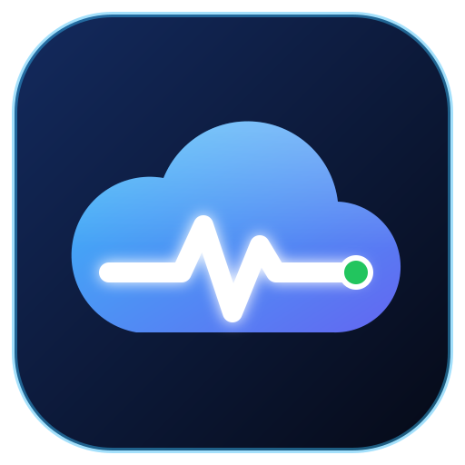

  

<h1 align="center">PulseSec</h1>

<b>The health of 46 Microsoft cloud services on one live Windows dashboard — with alerts the moment something breaks.</b>

  
  
  
  

## What it does

| Area | Items |
|---|---|
| 🏢 **Microsoft 365** | Overall, Exchange Online, Teams, SharePoint Online, OneDrive for Business, Office apps, Microsoft 365 Copilot, Power BI, Power Platform, Dynamics 365, Admin center |
| 🛡️ **Identity & security** | Entra ID (sign-in), Intune, Defender, Purview |
| ☁️ **Azure** | Overall, Virtual Machines, Storage, Networking, SQL & Cosmos DB, Kubernetes (AKS), App Service, Key Vault, Azure OpenAI & AI |
| 🛠️ **Developer** | Azure Boards, Repos, Pipelines, Test Plans, Artifacts · GitHub Git & PRs, Actions, Copilot, Codespaces, API |
| 🎮 **Consumer & gaming** | Outlook.com, OneDrive (personal), Teams Free, Copilot app, Office for the web, To Do, Phone Link, Xbox network, Minecraft, Bing, Windows Update, Microsoft Store |
| 🔐 **Threat intel** | Exploited Microsoft flaws from CISA's KEV catalog, Microsoft security updates (MSRC), the Patch Tuesday countdown and cyber news |

## Features

- **One live dashboard** — every service as a tile with its status, a 24-hour history strip and a headline count of what's wrong; checks every 2 minutes
- **Instant alerts** — a pop-up (with optional chime) when a service goes down, and again when it recovers, with a link to the status page
- **Critical services** — star the services that matter most; they sound a repeating alarm until someone acknowledges it and set the SOC threat level
- **SOC wall view** — full-screen view for a big screen: threat level, counters, status matrix, 7-day event log, 24-hour heat map, exploited flaws, Patch Tuesday and world clocks (press **S** or **F11**)
- **Every incident one click away** — official notices, outage news, 24-hour history and 7 days of changes for each service
- **More places to check** — one-click links to your admin center Service health, the Azure portal, Downdetector, news and the official status accounts on X
- **Recent changes** — every status change from the last 24 hours on the dashboard; click one to open that service
- **Find and filter** — search with **Ctrl+F** or **/**, click a coloured count to see only that level, or switch to issues only (**I**)
- **Quiet when you need it** — pause all alerts for 1 hour, 4 hours or until tomorrow morning, or mute one service without hiding it
- **Copy summary** — copy the current issues, or one service's details, to paste into Teams or email
- **Tray app** — services with issues listed right in the tray menu, plus check now, copy summary and pause alerts
- **Automatic updates** — every install checks this repository; when a newer version is out, an **Update** button appears and installs it in one click, with the download verified against its checksum
- **Security hardened** — sandboxed windows, locked-down links and permissions, checked settings, and it refuses to start if its app files have been altered
- **Works on company networks** — uses the Windows proxy and certificate settings automatically
- **Start with Windows** option, compact view, keyboard shortcuts (**F5** check now, **C** compact, **Esc** close)

## Install

1. Download **[PulseSec-Setup.exe](https://github.com/Degederon/PulseSec/raw/main/PulseSec-Setup.exe)** from this repository.
2. Run it from your Downloads folder. It's one click: no questions. If an older version is installed or running, Setup closes it and installs the new one — your settings and history are kept.
3. PulseSec opens on the dashboard and sits in the tray. Star your critical services under **Settings → Tiles**.

> Windows SmartScreen may say "Windows protected your PC" because the installer isn't code-signed — click **More info → Run anyway**. Don't run Setup from inside a zip or from an administrator window.

### Install for a whole team

IT can install silently, for example through Intune: `PulseSec-Setup.exe /S`. Each copy then keeps itself up to date from this repository.

### Uninstall

Windows Settings → Apps → PulseSec → Uninstall.

### Open the dashboard any time

Click the tray icon, or start the app again.

## Privacy

PulseSec reads only public pages: Microsoft's status pages (Microsoft 365, Azure, Power Platform, Azure DevOps), GitHub's status page, Google News outage headlines, CISA, Microsoft's security update guide and security news feeds — plus this repository to check for updates. It needs no sign-in and never touches your tenant. Settings stay on your PC in `%APPDATA%\PulseSec\settings.json`. No accounts, no tracking.

PulseSec shows Microsoft's public status. Problems that only affect your own organization appear in your Microsoft 365 admin center under **Service health**. PulseSec is an independent app and is not affiliated with or endorsed by Microsoft.

## License

[MIT](LICENSE) © 2026 Degederon · [EPOMD Training Labs, EZ Tools and More](https://www.youtube.com/@epomd)
